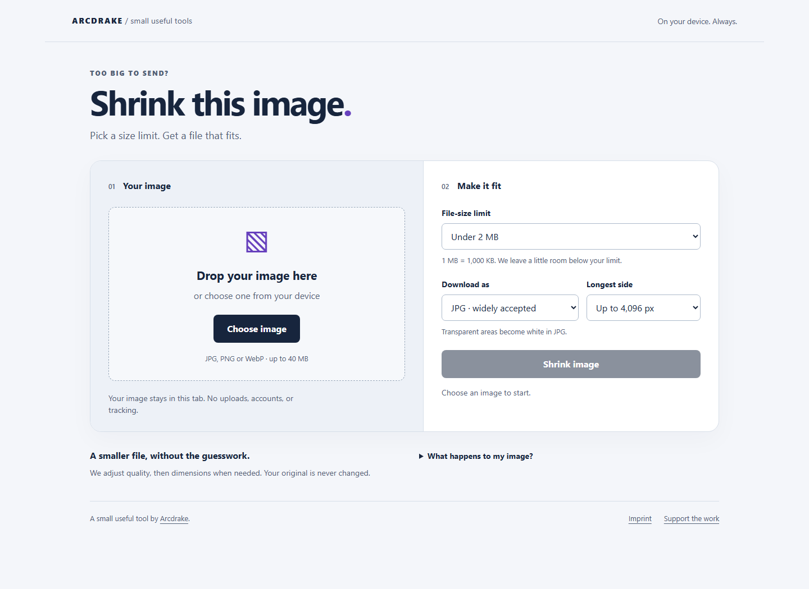

# Shrink This Image

**Make an image fit a file-size limit, privately in your browser.**

Choose one still JPG, PNG or WebP, set a file-size limit, preview the result and
download a newly encoded copy.
No account, upload, server-side processing, or API key. A small useful tool by
[Arcdrake](https://arcdrake.com/).



[Mobile result preview](docs/mobile-screenshot.png) uses synthetic test imagery.

**Status:** Source release. Production hosting is not yet live; run locally below.

## Try it locally

Requires Node.js 24 or newer. No install or build step:

```sh
npm start
```

Open **http://127.0.0.1:4178**. To stop the local server, press Ctrl+C.
Serve through HTTP; opening `index.html` directly as a file will not load modules.

## What it does

- File picker and drag-and-drop for a single still image.
- 2 MB, 1 MB, 500 KB, 100 KB, or a custom 50 KB–20 MB limit (decimal units).
- JPG, WebP or PNG output; optional longest-side limits, without upscaling.
- Checks actual encoded bytes and leaves 2% headroom under the chosen limit.
- Tries quality between 0.55 and 0.92 first, then reduces dimensions as needed.
  PNG uses resizing instead of lossy quality settings.
- Shows output dimensions, size, savings and preview before downloading.
- Applies EXIF orientation; original metadata is not copied into the re-encoded image.
- Keeps transparency in PNG/WebP. JPG explicitly uses a white background.
- Clear errors for unsupported, animated, corrupt or oversized inputs.

This is a bounded single-image compressor, not a batch processor, editor, metadata
forensics tool, or guarantee of visually lossless output. It searches a bounded
set of quality/size choices, not every possible encoding. A tiny original may
already be smaller than its new encoding; the interface says so. Always inspect
small text before sharing. Browser colour conversion can change appearance.

## Privacy

Images live only in the current tab's memory. There are no uploads, analytics,
cookies, third-party scripts, remote fonts, or runtime requests. Only your chosen
interface language is saved in browser storage; images and settings are not.
Once loaded, offline processing is verified in Chromium and Firefox. In WebKit
testing, choosing a new file while offline failed; the app shows an error. Safari
on Apple hardware was not tested (see the verification note). Clear releases preview URLs and the decoded
image; closing the tab releases the app state. Downloaded files are saved by the
browser at your request. Visible sensitive content is **not** removed.

A static host still receives ordinary page/asset requests and may keep access
logs. External footer links leave the app only when selected. Hosting-provider
logging belongs to the eventual deployment configuration.

## Compatibility and limits

Tested locally in Chromium, Firefox and WebKit desktop engines; see
[verification](docs/VERIFICATION.md). Physical phones and Safari on Apple hardware
were not tested. Use a current browser with `createImageBitmap` and Canvas support.
WebP export is capability-checked: unsupported browsers receive a clear suggestion
to choose JPG or PNG, never a mislabeled PNG.

Inputs: still JPG/PNG/WebP up to 40 MB, 40 million pixels and 16,384 pixels per side.
Animated PNG/WebP, GIF, SVG, HEIC, AVIF, RAW, multiple-file batches and video are
outside v1. Files are signature-checked before decoding.

## Checks and deployment package

```sh
npm run check
npm run package
```

`release/shrink-this-image-1.0.0.zip` contains only deployable static assets and
the license. `release/manifest.json` lists sizes and SHA-256 hashes.
Local packages are for inspection. Production uses the approved workflow artifact
described in [the release procedure](docs/RELEASING.md).
There are no secrets, runtime dependencies, migrations, or backend services.
See [deployment instructions](docs/DEPLOYMENT.md).

Browser tests use the locked Playwright dependency and start their own preview server:

```sh
npm ci
npx playwright install chromium
npm run test:ci
```

Generated fixtures, browser reports and downloads live under ignored `artifacts/`.

## Development

`dist/` is the application source; production uses the approved release artifact.
`image.js` contains validation,
header inspection and compression; `app.js` owns the interface and object-URL
lifetime. Tests use generated synthetic images, never private user images.
An optional WebMCP tool exposes the same compression action for an image the user
has already chosen; it cannot select/read new files or automatically download them.
It reports the derived output filename, size and dimensions to the calling agent;
the filename may retain identifying words from the original. Calling it replaces
the current compression result. Native WebMCP behavior remains unverified.

For changes, describe the problem and include a reproducer using non-private
fixtures. Run the relevant checks before committing.

MIT licensed; see [LICENSE](LICENSE) and the
[third-party material inventory](THIRD_PARTY_NOTICES.md). No external artwork or
fonts are bundled.

## Source, support and development

[Source](https://github.com/ArcdrakeStudios/shrink-this-image) · [Issues](https://github.com/ArcdrakeStudios/shrink-this-image/issues) · [Contributing](CONTRIBUTING.md) · [Security](SECURITY.md)

Part of Arcdrake's tools collection. The planned shared home is `tools.arcdrake.com`;
production hosting is not live as part of this source release. Local use is available
above. Development checks use Node.js 24 and locked Playwright tooling:

```sh
npm ci
npx playwright install chromium
npm test
npm run test:ci
npm run package:release
```

The CI wrapper starts and stops its own preview server. Runtime operation needs no
package installation. [Release procedure](docs/RELEASING.md).

## Languages

The full interface is available in German and English. Open `?lang=de` or
`?lang=en` to choose explicitly, or use the visible language selector. An explicit
query takes priority over the saved preference (`arcdrake-tools-language` in
localStorage), then the browser language; other languages fall back to English.
Only the language preference is saved. Switching preserves the current image,
settings and output; filenames and image pixels are not translated.

The collection shell can dispatch/listen for `arcdrake-language-change` with
`detail: {language: 'de' | 'en'}`. Changes use `history.replaceState`, without a
reload. `dist/i18n.js` must be included when serving or packaging the app.

Run `npm run test:i18n` for static copy coverage, translated errors, image state
retention, language preference/event behavior, and actual image downloads. The
check starts a localhost server and closes its headless browser on completion.
